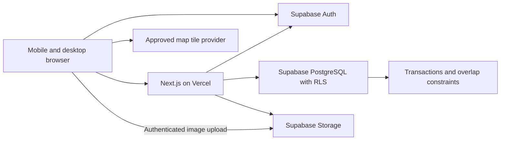

# PuyoHub architecture and product design

## 1. Product boundary

The first release helps a renter find a monthly rental, arrange a viewing, and receive an owner-confirmed reservation. It helps an owner advertise properties and keep individual rentable units from being reserved twice. An admin controls publication and handles moderation.

Primary market: Cabadbaran City, Philippines. Currency: PHP. Monthly prices display as `₱3,500 / month`. Store timestamps in UTC and render local events in `Asia/Manila`; rental start/end dates are calendar dates in that zone. Use English initially and keep copy easy to translate later.

An account can be both a renter and an owner. Admin is an additional privileged role. Switching dashboards changes the interface, not permissions.

### Required MVP

- Email/password signup, email verification, sign-in, password reset, and account settings.
- Public property search by barangay, property/unit type, monthly budget, amenities, and intended dates; list and map views.
- SEO-friendly listing pages, photo galleries, approximate location, pricing, and unit availability.
- Favorites, viewing requests, monthly booking requests, and an in-app request inbox.
- Owner onboarding, property details, individually reservable units, photos, monthly prices, availability blocks, and request decisions.
- Admin review of new listings and material edits, property verification, suspensions, reports, and an audit trail.
- Responsive loading, empty, validation, unauthorized, conflict, and retry states.

### Deferred

- Payment processing, deposits collected through the platform, automatic rent collection, invoicing, subscriptions, and refunds.
- Tenant ledgers, recurring bills, lease documents, maintenance tickets, owner staff accounts, and advanced analytics.
- Nightly stays, instant booking, chat, social login, reviews, recommendations, and automated identity verification.

Reservation confirmation is not a payment receipt or a signed tenancy agreement. Say this in request/confirmation copy. Display owner-provided deposit terms without collecting funds in the MVP. Give owners a response queue; unattended requests must not silently become confirmations.

## 2. Architecture

Use a modular monolith: one Next.js application and one Supabase project per environment. No separate API server, microservices, queue infrastructure, or ORM is required initially. SQL migrations are the schema source of truth; generate TypeScript database types from them.

- Server Components render public search results, property pages, and dashboard data. Use narrow client components for forms, favorites, galleries, and maps.
- Server Actions validate authenticated mutations. Route Handlers are for explicit HTTP integrations, sitemap generation where needed, and the auth callback. Avoid a second internal REST layer around every database query.
- Use `@supabase/ssr` for cookie-aware server clients and the browser client for Auth and supported uploads. Follow the installed Next.js version's auth refresh convention. Refreshing a session is not authorization: verify the user on the server and apply database policies on every request.
- PostgreSQL owns booking decisions, moderation transitions, role checks, and audit writes. Critical mutations call narrowly scoped database functions through the signed-in user's Supabase client.
- Every exposed table has RLS; custom functions also check identity and ownership. Application UI checks are for usability, not enforcement.
- Do not use a service-role key in ordinary application requests or public clients. Provision the first admin through a controlled database operation, never a public signup field.
- Public browse queries use public-safe projections. Keep cookie-bound dashboard queries out of shared caches. Cache only approved public listing content; invalidate by listing tag after moderation and do not cache request decisions or availability reads as authoritative.
- Use PostgreSQL filters, indexed joins, and cursor pagination. Start without a dedicated search service or PostGIS. Store public coordinates for map bounds; add spatial indexing when measurement justifies it.

Leaflet runs only in a client component loaded without server rendering. Keep an HTML listing and location description available without JavaScript. Choose a tile provider whose terms and usage limits fit a production marketplace; Leaflet itself does not supply tiles. Keep required attribution visible. Do not use a public geocoding endpoint for unrestricted autocomplete. Initially let owners place a pin and enter a barangay/address manually.

## 3. Roles and trust boundaries

| Capability | Visitor | Renter | Owner | Admin |
| --- | --- | --- | --- | --- |
| Browse approved published listings | Yes | Yes | Yes | Yes |
| Favorite and request | No | Own account | Own account, other owners' units | Own account if enabled |
| Edit a listing | No | No | Owned draft or paused listing | Moderation tools |
| Read request/contact details | No | Own requests | Requests for own property | Authorized support/moderation |
| Approve a request or manage blocks | No | No | Owned units | No ordinary owner impersonation |
| Verify/publish/suspend a listing | No | No | Submit for review only | Yes |
| Assign admin privileges | No | No | No | Controlled operator action |

Owners cannot reserve their own units. A suspended account cannot submit requests, publish/edit listings, or approve new bookings; existing records remain available for support. Public profile responses never expose renter emails, phone numbers, private addresses, or role administration fields.

## 4. Pages and navigation

| Route | Purpose | Access and behavior |
| --- | --- | --- |
| `/` | Local landing page; search; curated approved properties | Public, crawlable |
| `/properties` | Search, filters, sort, pagination, list/map toggle | Public; filters in URL |
| `/properties/[slug]` | Gallery, features, units, terms, approximate map, request actions | Public only while published; otherwise 404 |
| `/login`, `/signup` | Account access | Redirect authenticated users safely |
| `/forgot-password`, `/reset-password` | Password recovery | Validate recovery session |
| `/auth/confirm` | Signup/recovery/email callback | Validate token and same-origin redirect |
| `/dashboard` | Choose renter/owner workspace | Authenticated |
| `/dashboard/favorites` | Saved properties | Current account |
| `/dashboard/requests` | Booking and viewing inbox | Current account |
| `/dashboard/requests/[id]` | Request timeline, status, allowed cancellation | Participant; unauthorized IDs return 404 |
| `/dashboard/settings` | Profile and private contact information | Current account |
| `/become-an-owner` | Owner onboarding and terms acceptance | Authenticated; adds owner capability |
| `/owner` | Listing status, vacancy summary, pending requests | Owner |
| `/owner/properties` | Property collection | Owner |
| `/owner/properties/new` | Create draft | Owner |
| `/owner/properties/[id]/edit` | Details, units, photos, pricing, publication status | Owning account |
| `/owner/requests` | Review booking/viewing requests | Owning account |
| `/owner/availability` | Per-unit blocks and reservations | Owning account |
| `/admin` | Pending reviews and platform counts | Admin |
| `/admin/properties`, `/admin/properties/[id]` | Review, verify, reject, suspend | Admin |
| `/admin/users`, `/admin/reports` | Account suspensions and report resolution | Admin |
| `/terms`, `/privacy`, `/help` | Service terms, data use, support process | Public |

Route groups such as `(public)` organize layouts and do not appear in URLs. Redirects and menus improve navigation; each server operation must independently authorize access.

## 5. Main user flows

### Renter discovery and reservation

1. Search Cabadbaran by barangay, monthly budget, unit type, and optional dates.
2. Inspect an approved listing, available unit, photos, approximate map, and rental terms.
3. Sign up or sign in. Preserve the chosen listing in a validated same-origin return path. Require a verified email to submit requests.
4. Favorite the property, request a viewing, or request one unit with a move-in date and optional move-out date.
5. Submit contact-sharing consent, a short note, and the displayed price/terms version. The server rechecks the live offer; ask for reconfirmation if the offer changed.
6. The request is pending and does not hold inventory. Explain that several renters may request the same unit.
7. Owner approval atomically reserves the requested date range. Show a confirmation and immutable agreed monthly price/deposit terms. In-app status is the MVP notification channel; do not imply an email was delivered.
8. A conflict leaves the request unapproved and asks the owner to choose another unit/date or reject it. The renter can withdraw a pending request or cancel a future confirmed reservation under the displayed policy.

The first release allows cancellation of confirmed reservations before move-in; after move-in, ending a reservation is an owner/support action with a recorded reason and end date. Clearly disclose this before submission. Do not erase past occupancy history when a renter moves out.

### Viewing

Renter proposes a future time and message → owner accepts, declines, or asks the renter to submit another time → participants see the confirmed appointment. Viewings do not reserve units or count as bookings. Exact address and owner business contact become accessible to the requesting renter only after an accepted viewing or confirmed booking, following disclosed consent. There is no viewing-to-booking conversion that silently reserves inventory.

### Owner publication and operations

Activate owner capability → create property draft → enter private address and approximate public pin → add units with monthly prices and terms → upload validated photos → preview → submit → admin verifies/reviews → publish.

The public site displays a verification badge only for the scope the admin actually checked; avoid implying a safety guarantee. For the solo-founder MVP, editing public details on a published listing first pauses it; re-review is required before republishing. Warn the owner about that consequence. Availability blocks can be managed without republishing. Never let edits to photos, unit prices, or amenities bypass that lifecycle.

Owner approves/rejects requests from a request detail view. Owner-entered walk-in occupancy is a dated manual allocation with a private note; block the unit through the same overlap guard. This is sufficient before building tenant management.

### Admin moderation

Inspect the listing, photos, private address, ownership/contact evidence, and unit/pricing details → approve or return a reason → audit the decision. Suspension immediately removes public visibility and prevents new approvals. Existing reservations remain in the participants' dashboards. Resolve reports through recorded actions rather than deleting records. Require MFA for admin accounts before production access.

## 6. UI/UX direction

Use a calm, practical local-market style: teal primary actions, warm neutral surfaces, charcoal text, readable system/sans typography, and real property photography. Prefer clear information density to decorative dashboard widgets. All listings show monthly price, barangay, unit type, key amenities, and honest availability.

- Mobile: one-column cards, persistent search, filter sheet, list/map toggle, and a property-page request bar that does not cover content.
- Desktop: two-column search/map view; owner/admin sidebars; consistent page headers and action placement.
- Use accessible primitives, labeled form controls, keyboard-operable dialogs, visible focus, sufficient contrast, and touch targets around 44px. Never communicate verification or status through color alone.
- Form validation runs on both client and server. Preserve entered data on conflicts or failures. Explain monthly terms, whether utilities are included, deposit terms, and cancellation rules before submission.
- Photo upload shows progress, rejection reasons, and reorder/remove actions. Empty dashboards contain one useful next action.
- Define skeletons and error boundaries for search, property detail, and request pages. A failed map must not hide usable listing results.

## 7. SEO, privacy, and operational choices

Generate metadata, canonical links, social images, and a sitemap for published property pages. Keep slugs unique and stable. Add structured data only for facts actually represented. Use `noindex` on auth, dashboards, preview routes, and arbitrary filtered search variants. Return 404 for unpublished property URLs and remove them from the sitemap/cache after moderation.

Treat exact addresses, phone numbers, request messages, and viewing times as private personal data. Collect only needed fields, document consent and retention, and use a manual export/deletion support process before implementing automated account deletion. Do not hard-delete accounts with active reservations. Review Philippine Data Privacy Act obligations and marketplace terms before launch.

Use separate local, staging, and production databases. Log request IDs and error codes, never auth tokens or private request payloads. Track counts of published properties, pending requests, successful confirmations, and conflicts using database aggregates initially. Add error monitoring, database backup/restore checks, upload limits, signup/request rate limits, and a support contact before public launch.
