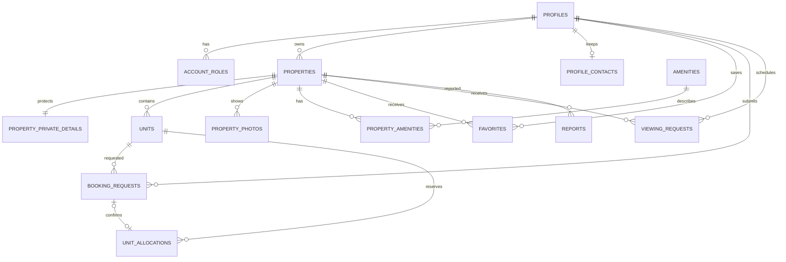
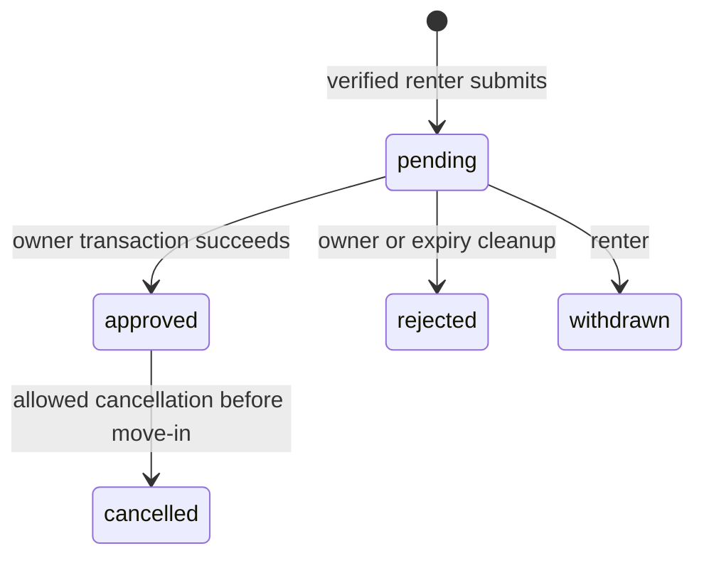

# Database and authorization design

The core schema, RLS, role/account functions, and booking/viewing RPCs are now implemented in `supabase/migrations/` and validated against local PostgreSQL, Auth, and PostgREST. Hosted application is a separate operator step; see [Supabase setup](supabase-setup.md). This document remains the architecture specification, including planned photo/publication UI and later refinements. The actual migrations are authoritative for current function names/signatures.

## 1. Modeling rules

- UUID primary keys; `timestamptz` creation/update/audit times; calendar `date` values for occupancy; prices as `numeric(12,2)`, never floating point. PHP is the only MVP currency.
- Every account has a private profile and may hold several roles. Renter is granted on signup. Owner activation is explicit and self-service; admin assignment is an operator-only operation.
- One property belongs to one owner. One **unit** represents one reservable bedspace, room, or entire apartment. A six-bed room contains six units; never book a room row as well as its beds. A `room_label` groups bedspaces for the UI without introducing a second inventory system.
- A booking request is an expression of interest. A **unit allocation** is inventory reserved by a confirmed booking, owner-entered occupancy, or maintenance/unavailability block. No separate mutable `is_available` flag.
- Every occupancy interval is `[start_date, end_date)`. An absent end means indefinite occupancy. Checkout and move-in may happen on the same date. A unit with an indefinite allocation cannot accept any later overlapping reservation until an end is recorded.
- Owners can manage several properties without a workspace/organization abstraction. Later, add organization membership and backfill property ownership if collaboration becomes necessary.

## 2. Entities and key columns

All main entities include `id`, `created_at`, and where useful `updated_at`. Foreign keys use restrictive deletion for bookings, allocations, role/audit history, and owned properties. Archive business records rather than cascading away reservation evidence. Profile/favorite cleanup can be handled deliberately after account retention checks.

| Table | Important columns and constraints |
| --- | --- |
| `profiles` | `id` PK/FK → `auth.users.id`, `display_name`, `account_status` (`active`, `suspended`). Own-account read; account status is operator-managed. No public email column. |
| `profile_contacts` | `user_id` PK/FK → profiles, optional private `phone`. Auth email remains in Supabase Auth. Participants receive only explicitly consented contact fields. |
| `account_roles` | Composite PK `(user_id, role)`; `role` = renter/owner/admin. No self-assignment of admin. |
| `properties` | `owner_id`, unique stable `slug`, `title`, `description`, `property_type` (boarding_house, apartment_building, house), `barangay`, `city`, `province`, `public_latitude`, `public_longitude`, `status` (draft, pending_review, published, paused, rejected, suspended, archived), `verified_at`, `verified_by`, `version`. City/province default to Cabadbaran/Agusan del Norte; validate coordinates and text lengths. |
| `property_private_details` | `property_id` PK/FK, `street_address`, optional precise coordinates, `contact_name`, `contact_phone`, `access_instructions`. Never returned in public listing queries. |
| `amenities` | Small seeded catalog: Wi-Fi, private/shared bathroom, kitchen, parking, air conditioning, utilities included, etc. Stable `code`, label. |
| `property_amenities` | Composite PK `(property_id, amenity_id)`; no free-form identifiers. |
| `units` | `property_id`, unique `(property_id, label)`, optional `room_label`, `unit_type` (bedspace, private_room, entire_apartment), `monthly_rent`, `deposit_amount`, `terms`, `offer_version`, `active`. Prices nonnegative; rent strictly positive. One occupant/household allocation per unit regardless of sleeping capacity. |
| `property_photos` | `property_id`, optional `unit_id`, unique `storage_path`, `alt_text`, `sort_order`, `is_cover`, `status` (pending, approved, rejected). If supplied, unit must belong to the property. Limit count and allow one cover via a partial unique index. |
| `favorites` | Composite PK `(user_id, property_id)`. Renter manages only their rows. |
| `booking_requests` | `renter_id`, `unit_id`, `start_date`, nullable `end_date`, `status` (pending, approved, rejected, withdrawn, cancelled), `message`, `contact_consent_at`, `offered_monthly_rent`, `offered_deposit_amount`, `offered_terms`, `offer_version`, `expires_at`, `decided_by`, `decided_at`, `decision_reason`, `idempotency_key`. Unique `(renter_id, idempotency_key)`; immutable renter/unit/offer after submission. |
| `unit_allocations` | `unit_id`, optional unique `booking_request_id`, `kind` (booking, manual_occupancy, blocked), `start_date`, nullable `end_date`, generated `period`, `released_at`, `created_by`, private `note`. Booking kind requires a booking FK; other kinds disallow it. Exclusion constraint below. |
| `viewing_requests` | `renter_id`, `property_id`, `requested_at` (`timestamptz`), `status` (pending, accepted, declined, withdrawn, cancelled, completed), `message`, `contact_consent_at`, `expires_at`, `decided_by`, `decided_at`, `decision_reason`. No inventory allocation. |
| `reports` | `reporter_id`, `property_id`, bounded `reason` and `detail`, `status` (open, resolved, dismissed), `resolved_by`, `resolved_at`. Reporter and admin only. |
| `audit_events` | `actor_id`, `action`, `entity_type`, `entity_id`, `occurred_at`, minimal structured `metadata`. Append-only; no contact details, tokens, or full request bodies. Written by controlled functions only. |

For a property that is a single apartment, create one `entire_apartment` unit. Do not model a multi-unit building as one reservable listing with a mutable quantity counter. The number of beds is the number of active bedspace units, making confirmation integrity simple.

Normalize at this level initially. Do not add tenant invoices, payment intents, subscription entitlements, chat messages, or generalized workflow tables until those features are built.



## 3. Database constraints and indexes

Critical allocation constraint, shown as design SQL (extension location must match the chosen Supabase project):

```sql
create extension if not exists btree_gist with schema extensions;

-- Columns inside the eventual public.unit_allocations definition:
-- start_date date not null,
-- end_date date,
-- released_at timestamptz,
-- period daterange generated always as
--   (daterange(start_date, end_date, '[)')) stored,
-- check (end_date is null or end_date > start_date)

alter table public.unit_allocations
  add constraint unit_allocations_no_overlap
  exclude using gist (
    unit_id with =,
    period with &&
  ) where (released_at is null);
```

`btree_gist` supplies UUID equality support. Confirm its installed schema/operator class resolution in the migration. The constraint is the final defense for concurrent writes; a browser availability check cannot replace it. Expiry/maintenance jobs must never disable the constraint.

Additional constraints and indexes:

- Validate `end_date > start_date` when present on requests and allocations. Validate that new move-in dates are not in the past using Manila's date in the submission function, not a time-dependent CHECK constraint.
- Unique pending `(renter_id, unit_id)` prevents repeat spam on one unit; retry the original request or withdraw it first. Expire stale requests before deciding whether a new one is allowed.
- Unique `unit_allocations.booking_request_id`; approval function and a constraint trigger ensure the request, unit, and dates agree. Restrict cross-table link mutations to controlled functions.
- `properties(status, city, barangay, id)` for public search and `properties(owner_id, id)` for dashboards.
- `units(property_id, active, monthly_rent, id)` for property queries; measure before adding a separate budget-first index.
- `booking_requests(renter_id, created_at desc, id)` and `(unit_id, status, created_at desc, id)`; `viewing_requests(property_id, status, requested_at)` and `(renter_id, created_at desc, id)`.
- Unique `favorites(user_id, property_id)` and `property_photos(property_id, sort_order, id)` index.
- Index foreign-key columns used by ownership/RLS checks, especially units' property and properties' owner. Add indexes for reverse lookups where required by observed query plans.

Public search uses bounded page sizes and stable sorting with an ID tiebreaker. Map requests return only approved public pins within bounds, with a hard result cap. Availability uses overlap queries against allocations and exposes only a yes/no or date-range summary, never private allocation reasons or renter identity. A displayed vacancy is advisory until approval commits.

## 4. Booking state machine and atomic approval



Move-in/move-out are derived from allocation dates, not a second booking status workflow. Completed stays remain approved historical records with finite end dates. To finish an indefinite stay, set a valid end date through a controlled owner function and preserve the allocation. Before-move-in cancellation records `released_at`; ordinary move-out does not release historical dates. Pending requests expire after a configurable period (initially seven days, or before the requested start becomes past). Approval and submission functions check expiry synchronously; a scheduled cleanup job is optional, not a correctness dependency.

`approve_booking(request_id)` executes as a single PostgreSQL function/transaction:

1. Require `auth.uid()`, an active account, verified email, and ownership of the property. Lock the request row, then the property's row, then its unit row in a documented order used by other request/availability mutations. Publication/suspension operations take the property lock too.
2. A repeated approval of the same request returns its existing confirmation after authorization. Reject other terminal states and expired or past-start requests.
3. Require the property to be published, the owner active, the unit active, and the requester different from the owner. Verify the stored offer matches the unit's current offer version; otherwise reject with `OFFER_CHANGED` and ask for a fresh renter confirmation. No silent price substitution.
4. Insert the dated allocation. The exclusion constraint rejects any overlapping confirmed booking, manual occupancy, or block, including concurrent attempts. On overlap, return a typed conflict; roll back the whole approval and keep the request pending.
5. Set request status/decision time, append the audit event, and return the confirmation. No email, external HTTP request, or UI state participates in this commit.

The request remains pending if the transaction fails. Other pending requests need not be rejected automatically; the owner can offer alternatives through a new explicit request or reject them. They cannot be approved against occupied dates.

Additional controlled functions:

- `submit_booking(...)`: verified active renter; published active unit; consent/date/offer checks; idempotency; current-overlap precheck; insert pending request.
- `withdraw_booking(id)`: renter's pending request only.
- `reject_booking(id, reason)`: owning active account; pending request only.
- `cancel_booking(id, reason)`: authorized participant before start date, or privileged support action with explicit reason; update request and release allocation atomically. All allocation mutations use the same locking discipline.
- `end_allocation(id, end_date, reason)`: owner/support only; finite valid end date, preserve history, reject dates before start or contradictory future records. Changes are audited.
- `create_manual_allocation(unit_id, dates, kind, note)` and `release_future_block(id)`: owner only; overlap constraint applies. Manual occupancy ending follows the historical-end rule.
- `submit_viewing`, `decide_viewing`, `withdraw_viewing`: participant checks, future time validation, consent, state checks. No allocation writes.
- `activate_owner`, `save_property_draft`, `save_unit`, `submit_property`, `moderate_property`, `suspend_account`: explicit field allowlists and transitions. Admin status/verification cannot be supplied through owner payloads.

The migration implements these behaviors through `submit_booking`, `approve_booking`, `decide_booking` (withdraw/reject/cancel), `create_manual_allocation`, `end_allocation`, `release_future_block`, and the viewing/account/property RPCs. See generated database types for exact signatures. Return predictable codes such as `FORBIDDEN`, `INVALID_STATE`, `REQUEST_EXPIRED`, `OFFER_CHANGED`, and `UNIT_UNAVAILABLE`; do not expose raw SQL or whether another renter exists.

## 5. RLS and database privileges

Default deny. Enable RLS on every table in an exposed schema and consider `FORCE ROW LEVEL SECURITY` where compatible with the chosen controlled-function ownership strategy. Revoke generic writes from `anon` and `authenticated` except explicitly permitted self-scoped operations (for example favorites). Grant EXECUTE on each mutation function only to its intended role; PostgreSQL's default PUBLIC execute grant must be revoked.

Use `security invoker` functions/views whenever normal policies suffice. For transactional privileged writes, use audited, narrowly scoped `security definer` functions with an empty fixed `search_path`, fully qualified relation/function names, explicit authorization, bounded input, and no caller-controlled SQL. A definer function can bypass policies; it must implement every authorization check itself. Put helper functions such as role/ownership checks in a non-exposed schema and grant only the execution needed by policies. Do not expose helpers that return arbitrary users' roles or contacts.

| Data | Anonymous | Authenticated renter | Owning account | Admin |
| --- | --- | --- | --- | --- |
| Profiles/contacts | None | Own private fields | Same plus consented request projection | Authorized support reads; controlled suspension |
| Roles | None | Own role read | Own role read | Controlled assignment only |
| Properties | Published, safe columns | Published | Own properties, all states | Review/suspend through audited paths |
| Private property details | None | Limited disclosure after accepted viewing/booking | Own | Moderation/support |
| Units/amenities | Published parent and active unit | Same | Own parent | Review reads |
| Photos | Approved, published parent | Same | Own pending/approved | Review |
| Favorites | None | Own CRUD | Own CRUD | No blanket need |
| Booking/viewing requests | None | Own read; constrained RPC transitions | Related read; constrained decisions | Support reads; exceptional audited actions |
| Allocations | None | No direct reads; public-safe availability function | Own detailed read; RPC writes | Support read; exceptional actions |
| Reports | None | Own create/read | Own reports only | Triage and resolution |
| Audit events | None | None directly | None directly | Read; no client writes |

RLS restricts rows, not update columns. It cannot prevent an owner from setting `verified_at` or a renter from changing `status` if broad UPDATE privileges remain. Use explicit grants, column-safe projections, and controlled mutation functions, rather than relying on hidden form fields.

Public views must use invoker security so policies are preserved. Public query functions must return an explicit allowlist of public columns, check published/verified state and the owner's active status, and enforce pagination. A projection in application code does not restrict direct API clients: revoke public SELECT on base relations with internal columns and expose a checked, column-safe read RPC instead. Invoker views are appropriate only when their required underlying grants are already safe. Never assume a view hides columns while leaving unrestricted base-table SELECT available. Do not expose `unit_allocations` through a permissive public policy merely to implement search. Non-public data must not leak through nested joins, Storage URLs, error messages, or public caches.

Profile contact disclosure should use a narrowly scoped participant RPC returning only consented fields; it must not grant an owner access to a renter's entire profile. Pending requests may expose the consenting renter's chosen contact to the responsible owner; exact property details require an accepted viewing or approved, uncancelled reservation. Record and document the policy, including how access ends after cancellation or a retention window.

Role lookup helpers must avoid policy recursion on `account_roles`. Do not authorize using editable `user_metadata`, a submitted owner ID, or the client-selected dashboard. Signup creates a renter profile/role through a safe trigger; subsequent owner onboarding grants only owner. Revoking a role or suspending an account must affect database decisions immediately, even when an old browser session remains open.

## 6. Photo storage

Use a private `property-photos` bucket initially. Object paths are generated from authenticated ownership: `<owner-id>/<property-id>/<random-id>.<allowed-extension>`. Upload policy verifies both the path owner and ownership of the referenced property. No arbitrary file paths from the client.

Allow JPEG, PNG, and WebP; reject SVG/HTML. Initially cap at 5 MB per source image and 15 photos per property. Check actual image decoding/type and dimensions on finalization, strip EXIF/location metadata before publication, and enforce count limits in the controlled finalize step. Extension and browser MIME alone are insufficient. Temporary uploads are unlisted and cleaned up safely after a bounded age.

Public pages obtain short-lived signed URLs only for approved photos whose property is currently published. Owner/admin preview can sign their permitted pending objects. Signed URLs are bearer links and remain usable until expiry; use a short TTL and document that suspension revocation is not instantaneous for previously issued URLs. Do not put unreviewed uploads into a public bucket. Avoid a paid image-processing pipeline initially; bounded server-side image validation/re-encoding can use a Node-compatible library in the application.

Changing/replacing approved photos follows the same pause/review rule as other material listing edits. Removal and orphan cleanup must verify ownership and must not delete another property's file.

## 7. Evolution without premature infrastructure

Future tenant management can reference existing owner, unit, profile, and confirmed booking IDs. A separate tenancy/lease domain should represent signed leases and renewals; do not overload pending booking requests into a rent ledger. Add payments with provider event IDs, idempotent webhook processing, and a ledger only when payment collection is in scope. Subscriptions belong to an owner/business entitlement model, separate from renter reservations. Preserve past agreed prices when unit prices change.
